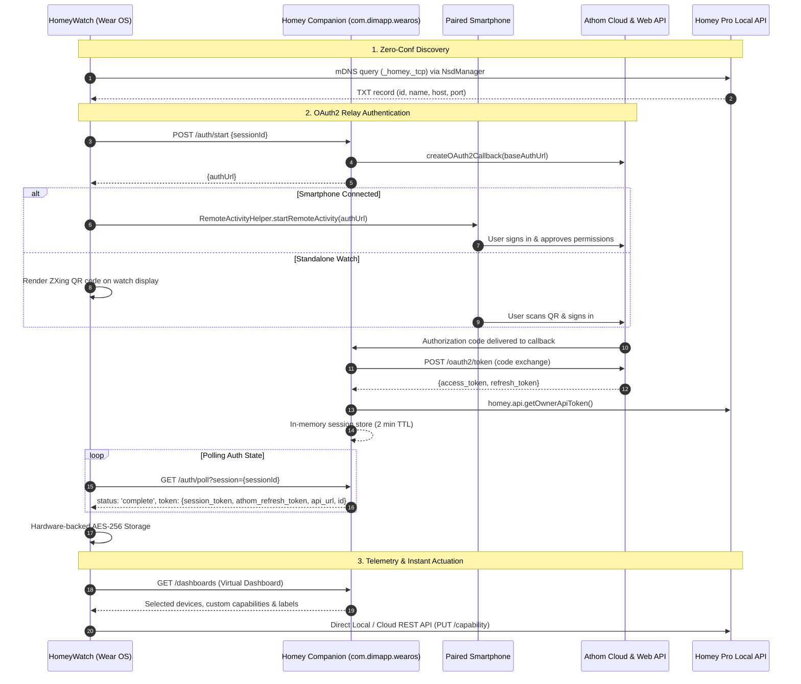

# Wear OS Companion for Homey ⌚🏡

[](https://apps.developer.homey.app/)
[](LICENSE)
[-4285F4.svg)](https://github.com/s-dimaio/HomeyWatch)

The official **Athom Homey Pro** companion application for **Wear OS**. It acts as a secure OAuth2 relay, virtual dashboard provider, and local API gateway for the standalone [HomeyWatch](https://github.com/s-dimaio/HomeyWatch) smartwatch application.

---

## 🌟 Overview

The **Wear OS Companion** app bridges your Athom Homey Pro smart home ecosystem with your Wear OS 3+ smartwatch. By decoupling client orchestration from a paired smartphone, this companion app allows [HomeyWatch](https://github.com/s-dimaio/HomeyWatch) to operate completely standalone:
- Bootstraps secure OAuth2 authorization directly on the watch or through a smartphone handoff.
- Generates tailored "Virtual Dashboards" optimized for Wear OS 2x2 Glanceable Tiles and favorite device chips.
- Exposes filtered device and zone proxies with automated quick-action heuristic candidate ranking.
- Houses an enterprise-grade, persistent diagnostic logger with strict privacy sanitization (PII).

---

## 🏗️ Architecture & Topology

The integration consists of two decoupled repositories:

1. **Homey Companion App** (*this repository*):
   - Runs directly on Athom Homey Pro (SDK v3, Node.js).
   - Manages authorization sessions, Athom Cloud token delegation, dashboard preferences, and diagnostic file logging.
2. **Wear OS Client App ([HomeyWatch](https://github.com/s-dimaio/HomeyWatch))**:
   - Native Kotlin & Jetpack Compose application running independently on Wear OS 3+ (`minSdk 30`).
   - Uses mDNS (`_homey._tcp`) for zero-configuration local discovery, rotary input, hardware-backed Keystore encryption (`EncryptedSharedPreferences`), and Glanceable ProtoLayout Tiles.



---

## ✨ Key Features

### 🔐 Hardened OAuth2 Relay & Session Management
- **Zero-Friction Authentication**: Starts pairing via `POST /auth/start` with strict 64-character hexadecimal session validation.
- **Dual Flow Flexibility**: Direct smartphone browser handoff (`RemoteActivityHelper`) or standalone watch QR code fallback.
- **Ephemeral Token Exchange**: Securely exchanges authorization codes with Athom Cloud, fetches the local owner API token, and buffers credentials in-memory with a strict **2-minute TTL** before destruction.
- **Silent Token Rotation**: Provides `POST /auth/refresh` to renew expired session tokens with Athom Cloud without requiring re-pairing.

### 🎛️ Virtual Dashboard & Quick Action Tiles
- **Wear OS 2x2 Tile Integration**: Generates a virtual dashboard (`/dashboards`) aggregating up to 4 user-selected priority devices for rapid glanceable actuation.
- **Capability Overrides**: Customize which primary capability is actuated (e.g., toggling `onoff`, opening a garage door `locked`, or dimming).
- **Custom Tile Labels**: Override device names with compact labels suited for circular watch viewports.
- **Heuristic Quick Actions**: Automatically detects and ranks supported capabilities (`_extractQuickActions`) across lights, locks, sockets, covers, and sensors.

### 🛡️ Enterprise Logging & Privacy Sanitization
- **Rotatable Diagnostic File Logging**: Persistent file logger (`LogManager.js`) stored in `/userdata`, automatically rotated up to 512 KB per file with 2 backup archives.
- **Strict PII & Token Redaction**: High-performance regex masking removes Bearer tokens, private secrets, session IDs, Athom ObjectIds (`677c***6f27`), GDPR-sensitive emails, and GPS coordinates from logs.
- **Web Settings Diagnostic Suite**: Real-time log inspector, file download, and truncation interface built into the Homey settings page.

---

## 🛠️ API Reference

The companion app exposes RESTful endpoints structured for the Wear OS client and management settings:

### Public Endpoints (Client Authentication & Synchronization)
| Method | Endpoint | Description |
| :--- | :--- | :--- |
| `POST` | `/auth/start` | Initiates an OAuth2 handshake. Validates `sessionId` and returns the Athom authorization URL. |
| `GET` | `/auth/poll` | Polls session status (`pending` or `complete`). Returns session tokens once authorized. |
| `POST` | `/auth/refresh` | Refreshes and rotates an existing session token using `athom_refresh_token`. |
| `GET` | `/dashboards` | Returns the virtual dashboard payload containing selected devices, custom capabilities, and labels. |
| `GET` | `/devices` | Helper for the settings UI listing controllable devices and candidate quick actions. |
| `GET` | `/zones` | Returns the hierarchical zone and room structure. |

### Protected Endpoints (Requires Homey Manager Permissions)
| Method | Endpoint | Description |
| :--- | :--- | :--- |
| `GET` | `/log/status` | Returns logger state, active log file size, and available backup archive files. |
| `GET` | `/log/download/:index` | Streams a specific diagnostic log file (`0` for current, `1..2` for backups). |
| `DELETE` | `/log/:index` | Deletes a specific diagnostic log file. |
| `DELETE` | `/log/all` | Purges all diagnostic log files and resets log indexes. |

---

## 🚀 Installation & Development

### Prerequisites
- [Homey CLI](https://npm.im/homey) installed globally:
  ```bash
  npm install -g homey
  ```
- Node.js 18 or higher (Node.js 22 recommended).
- An Athom Homey Pro hub connected to your local network.

### Local Development
1. Clone this repository:
   ```bash
   git clone https://github.com/s-dimaio/com.dimapp.wearos.git
   cd com.dimapp.wearos
   ```
2. Install project dependencies:
   ```bash
   npm install
   ```
3. Run the app in development mode with live console output:
   ```bash
   homey app run
   ```

### Staging & Production Deployment
Install the application permanently onto your Homey Pro:
```bash
homey app install
```

Validate the manifest and assets against Homey App Store publication requirements:
```bash
npx homey app validate --level publish
```

---

## 📦 Related Projects

- **[HomeyWatch (Wear OS Client)](https://github.com/s-dimaio/HomeyWatch)**: Standalone native Android application for Wear OS 3+ built with Jetpack Compose, Horologist, and ProtoLayout Tiles.

---

## ☕ Support & Donations

If you enjoy using this application and want to support ongoing development:

[](https://paypal.me/sdimaio77)

---

## 📄 License

This project is licensed under the **GNU General Public License v3.0 (GPL-3.0)** - see the [LICENSE](LICENSE) file for details.

